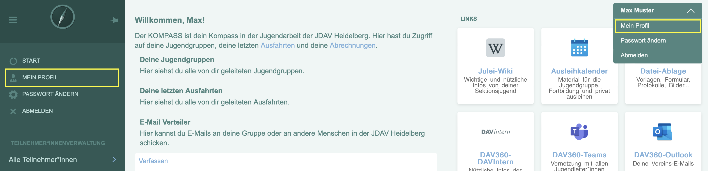

.. _user_manual/myprofile:

Mein Profil
===========

Der Kompass verwaltet vor allem die aktiven Personen in einer Sektion, jeder und jede hat ein persönliches Profil im Kompass.
Auch Du tauchst in der Teilnehmer\*innenübersicht auf. Du kannst dein Profil am einfachsten erreichen, indem
du im Menü ganz oben auf "Mein Profil" klickst.

Aufbau des Profils
------------------

Dein Profil ist genauso aufgebaut wie das Profil jeder anderen Person im Kompass. Es enthält verschiedene Reiter mit unterschiedlichen Informationen.
Der Aufbau des Profils ist im Detail in :ref:`detailansicht` beschrieben.

Mein Profil bearbeiten
----------------------
Du kannst über die allgemeinen Informationen der Teilnehmer\*in-Detailansicht hinaus in deinem eigenen Profil noch weitere Informationen pflegen:

- Im Reiter "Kontaktdaten" kannst du neben deiner Anschrift auch deine IBAN/Kontonummer eintragen. Diese wird z.B. benötigt, wenn du :ref:`abrechnung_einreichen` und ausgelegtes Geld erstattet bekommen möchtest.
- Im Reiter "Fortbildungen" kannst du deine besuchten Aus- und Fortbildungen eintragen. Mehr dazu findest du unter :ref:`user_manual/training`.
- Im Reiter "Notfallkontakte" kannst du Personen hinterlegen, die im Notfall kontaktiert werden sollen.

Diese und allen weiteren Informationen in deinem Profil solltest du immer aktuell halten.

.. _user_manual/two_factor:

Zwei-Faktor-Authentifizierung
-----------------------------

Mit einem zweiten Faktor ist dein Konto auch dann geschützt, wenn jemand dein Passwort kennt:
Nach dem Passwort fragt Kompass zusätzlich nach einem Code aus einer Authenticator-App oder nach
einem Sicherheitsschlüssel. Die Einstellungen findest du im Menü unter deinem Namen bei
"Zwei-Faktor-Authentifizierung". Ob du sie nutzt, entscheidest du selbst.

- **Authenticator-App** (z.B. Aegis, Google Authenticator, Microsoft Authenticator, 2FAS):
  Klicke auf "Authenticator-App hinzufügen", bestätige mit deinem Passwort, scanne den QR-Code
  mit der App (oder tippe den angezeigten Schlüssel ab) und gib zur Bestätigung den Code ein, den
  die App anzeigt.
- **Sicherheitsschlüssel oder Passkey** (z.B. ein YubiKey, dein Smartphone oder der
  Fingerabdrucksensor deines Laptops): Klicke auf "Sicherheitsschlüssel hinzufügen", gib einen
  Namen und dein Passwort ein und folge dann den Anweisungen deines Browsers. Kann der Schlüssel
  dich selbst prüfen (per PIN oder Fingerabdruck), wird er als **Passkey** angezeigt. Mit einem
  Passkey kannst du dich auf der Anmeldeseite über "Mit Sicherheitsschlüssel anmelden" auch ganz
  ohne Benutzername und Passwort anmelden.

Du kannst mehrere Apps und Schlüssel einrichten, sie umbenennen und wieder entfernen. Zum
Hinzufügen und Entfernen fragt Kompass jeweils noch einmal nach deinem Passwort.

**Wiederherstellungscodes:** Wenn du deinen ersten zweiten Faktor einrichtest, zeigt Kompass dir
zehn Wiederherstellungscodes an — nur dieses eine Mal. Bewahre sie sicher auf, etwa ausgedruckt
oder in einem Passwortmanager. Hast du keinen deiner Faktoren zur Hand, meldest du dich nach dem
Passwort mit einem dieser Codes an; jeder Code gilt nur einmal. Unter "Neue Codes erzeugen"
bekommst du jederzeit zehn neue, die alten verlieren dann ihre Gültigkeit.

Hast du alle Faktoren und alle Codes verloren, kann eine Person mit dem Recht, Benutzerkonten zu
bearbeiten, deine Zwei-Faktor-Authentifizierung in der Benutzerverwaltung zurücksetzen. Danach
genügt wieder dein Passwort, und du kannst neue Faktoren einrichten.

Wird ein Faktor entfernt oder deine Zwei-Faktor-Authentifizierung zurückgesetzt, bekommst du
eine E-Mail. Warst du das nicht, melde dich bitte sofort.

.. note::
   Nach fünf Fehlversuchen sperrt Kompass die Anmeldung mit zweitem Faktor für 15 Minuten, bei
   weiteren Fehlversuchen jedes Mal doppelt so lang (höchstens einen Tag). Bei der ersten Sperre
   bekommst du eine E-Mail.

   Meldet sich deine Sektion über einen externen Identitätsanbieter (OIDC) an, verwaltet dieser
   die Zwei-Faktor-Authentifizierung, nicht Kompass.
